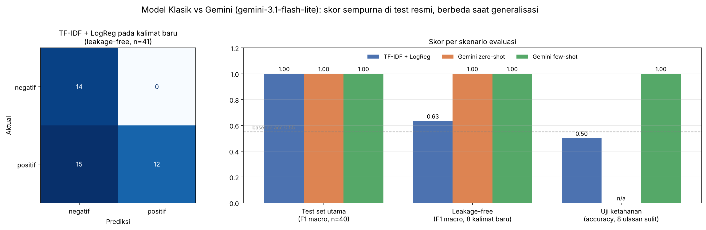

# AI Model Experiment & Evaluation: Customer Review Sentiment Analysis

**Classic Machine Learning (Scikit-learn) vs LLM API (Gemini)**
Individual Assignment, AI Engineering Bootcamp · Muhammad Ariel Shakaramiro



> **Summary:** On the official test set, both the classic model and Gemini achieve a perfect score (F1 1.00). However, 98% of the test sentences turned out to already exist in the training set. When tested on genuinely unseen sentences, the classic model drops to F1 0.52–0.63, while Gemini stays at 1.00 and also gets 8/8 on difficult reviews (typos, sarcasm, mixed sentiment, English). **Recommendation: develop Gemini zero-shot with an asynchronous + caching architecture**, then prepare a distillation path toward an in-house model.

---

## 1. Problem Statement

**Objective.** An e-commerce product team wants an automated feature that classifies the sentiment of customer reviews on product pages. This experiment compares two candidate approaches, a self-trained classic model and a prompt-based LLM API, and produces a **data-driven recommendation** on which approach should be developed for production. The comparison covers performance, implementation effort, speed, and cost.

**Target/label.** Binary classification of the `sentiment` column:

| Label | Definition |
|---|---|
| `positif` (positive) | The customer is satisfied or praises the product, delivery, or service |
| `negatif` (negative) | The customer is disappointed, complains, or reports a problem |

The model input is `review_text` only. `product_name` is not used because sentiment is determined by the review content.

**Constraints & assumptions.**
- The official assignment dataset is used without modification. Labels are treated as *ground truth*.
- Two classes only. Neutral or mixed reviews are out of scope.
- No deep learning training from scratch.
- API cost is estimated from actual token usage × Gemini API public pricing (October 2026). Prices may change.

## 2. Dataset

`data/customer_reviews_sentiment.csv`: 200 Indonesian-language reviews with columns `review_id`, `product_name`, `review_text`, `sentiment`.

| Characteristic | Value |
|---|---|
| Rows | 200 (110 positive / 90 negative, fairly balanced) |
| Missing values | 0 |
| **Unique review texts** | **only 40** (20 positive, 20 negative), each repeated 1–12× |
| Conflicting labels for identical text | 0 |
| Review length | 6–11 words |

**Key finding: data leakage.** Because there are only 40 unique sentences, a random row-level split (80/20, `random_state=42`, stratified) produces a test set in which **39 of 40 rows (98%) are identical to sentences in the training set**. This experiment therefore uses two evaluation schemes:

1. **Main split** (as specified in the brief/starter): the official comparison, with the **same** test set for both approaches (`results/test_set.csv`).
2. **Leakage-free split** (`GroupShuffleSplit` by unique text + 5-fold `GroupKFold` CV): measures generalization to sentences never seen during training. This test set is also used for **both** approaches.

## 3. Experiment Overview

### Approach 1: Classic Model (Scikit-learn)
- **Features:** `TfidfVectorizer(ngram_range=(1,2), sublinear_tf=True)`. Bigrams capture negations such as *"tidak sesuai"* ("not as described"). Stopwords are kept because *"tidak"* ("not") carries sentiment signal. This yields 384 features.
- **Model:** `LogisticRegression(max_iter=1000)`, fast and interpretable. Strongest weights: *lambat* (slow), *jauh dari* (far from), *rusak* (broken), *tidak sesuai* (not as described) for negative vs *cepat* (fast), *rapi* (neat), *puas* (satisfied), *recommended* for positive.
- **Baseline:** majority-class `DummyClassifier`.

### Approach 2: LLM API (Gemini)
- **Model:** `gemini-3.1-flash-lite`. The `gemini-2.0-flash` model used in the starter was shut down by Google (June 1, 2026), and the free-tier daily quota for `gemini-3.8-flash` ran out mid-experiment. For consistency, **all LLM predictions come from a single model**.
- **Prompt:** a system instruction defining the role, each label, a reminder about negation, and an "answer with one word" rule. Two strategies were tested:
  - **Zero-shot:** no examples.
  - **Few-shot:** + 4 labeled examples (2 positive, 2 negative) from the training set, **guaranteed not to appear in any test set**.
- **Parameters:**

| Parameter | Value | Reason |
|---|---|---|
| `temperature` | 0.0 | Classification needs deterministic, reproducible answers, not creativity |
| `thinking_level` | LOW | A simple task, so latency and "thinking" tokens can be kept low |
| `response_mime_type` + enum schema | `positif`/`negatif` | Constrains the output so it is always valid. Result: 0 invalid outputs. |
| `seed` | 42 | Reproducibility |

- **API calls:** one call per unique text, with results stored in `results/llm_cache.json`. Calls are spaced out to respect free-tier rate limits, and 429/503 errors are retried with increasing delays.

## 4. Evaluation Results & Comparison

### 4.1 Main test set (n = 40, same for all approaches)

| Approach | Accuracy | Precision (macro) | Recall (macro) | F1 (macro) | Negative recall | Latency / review |
|---|---|---|---|---|---|---|
| Baseline (majority class) | 0.550 | 0.275 | 0.500 | 0.355 | 0.000 | - |
| TF-IDF + Logistic Regression | 1.000 | 1.000 | 1.000 | 1.000 | 1.000 | ~0.02 ms |
| Gemini zero-shot | 1.000 | 1.000 | 1.000 | 1.000 | 1.000 | 6.5 s (median) |
| Gemini few-shot | 1.000 | 1.000 | 1.000 | 1.000 | 1.000 | 7.6 s (median) |

**Confusion matrix:** identical for all three approaches.

| | pred negative | pred positive |
|---|---|---|
| actual negative | 18 | 0 |
| actual positive | 0 | 22 |

**Interpretation.**
- **Accuracy 1.00:** all 40 reviews are correct, well above the 0.55 baseline.
- **Precision 1.00:** no *false alarms*. No positive review is flagged as negative.
- **Negative recall 1.00:** every complaint is caught. This is the most important business metric.
- **F1 1.00:** precision and recall are perfectly balanced.

However, this tie **cannot be used to choose an approach**. For the classic model, 1.00 is a leakage artifact (it has already "seen" 98% of the test sentences). For Gemini the score is genuine, because Gemini was never trained on this data. Few-shot also adds no accuracy over zero-shot, even though input tokens increase by ~76%.

### 4.2 Leakage-free evaluation (test sentences never seen during training)

| Approach | Accuracy | Precision (macro) | Recall (macro) | F1 (macro) | Negative recall |
|---|---|---|---|---|---|
| TF-IDF + LogReg (GroupShuffleSplit, n=41 / 8 unique texts) | 0.634 | 0.741 | 0.722 | 0.633 | 1.000 |
| TF-IDF + LogReg (5-fold GroupKFold, mean) | 0.540 ± 0.15 | 0.656 | 0.658 | 0.524 ± 0.16 | - |
| **Gemini zero-shot** (GroupShuffleSplit) | **1.000** | **1.000** | **1.000** | **1.000** | **1.000** |
| **Gemini few-shot** (GroupShuffleSplit) | **1.000** | **1.000** | **1.000** | **1.000** | **1.000** |

**Interpretation.** The classic model **collapses** to near-guessing level (0.54 accuracy in CV vs a 0.55 baseline). Its negative recall is 1.00, but its negative precision is only 0.48: **15 of 27 positive reviews are wrongly flagged as negative** (see the confusion matrix in the chart above). The model "accuses" a review of being negative whenever it meets an unfamiliar word. Gemini stays perfect (41/41). Note: this test set contains only 8 unique sentences, so the 1.00 score has wide uncertainty, but the direction is consistent with the robustness test.

### 4.3 Robustness test (8 hand-written reviews outside the dataset, illustrative)

| Challenge | Example (English gloss) | Label | Classic | Gemini few-shot |
|---|---|---|---|---|
| negation | Tidak mengecewakan sama sekali, bakal repeat order. *(Not disappointing at all, will order again.)* | positive | correct (p=0.54) | correct |
| slang + negation | Gak nyesel beli di sini, recommended bgt *(No regrets buying here, highly recommended)* | positive | correct | correct |
| sarcasm | Wah hebat, baru sehari dipakai udah rusak. Mantap. *(Wow great, broke after one day. Awesome.)* | negative | correct (p=0.45) | correct |
| mixed | Barangnya bagus sih, tapi pengirimannya lama banget dan kurirnya kasar. *(The item is good, but delivery was very slow and the courier was rude.)* | negative | wrong (positive) | correct |
| reversed expectation | Kirain bakal jelek, ternyata kualitasnya bagus banget. *(Thought it'd be bad, turns out the quality is great.)* | positive | correct | correct |
| abbreviation/typo | brg gk sesuai pesanan, admin jg slow resp *(item not as ordered, admin also slow to respond)* | negative | wrong (positive) | correct |
| contrast | Murah tapi bukan murahan, puas! *(Cheap but not cheaply made, satisfied!)* | positive | wrong (negative) | correct |
| English | Not recommended, quality is very poor. | negative | wrong (positive) | correct |
| **Total** | | | **4/8** | **8/8** |

The classic model only recognizes **words** it has seen before, not the **meaning** of a sentence. Even its correct predictions have probabilities of just 0.45–0.65.

### 4.4 Speed & cost

| | Classic model | Gemini zero-shot | Gemini few-shot |
|---|---|---|---|
| Initial effort | Needs labeled data + training | No training, prompt only | Prompt + 4 examples |
| Latency / review | ~0.02 ms (local CPU) | median 6.5 s · p95 22 s | median 7.6 s · p95 93 s |
| Tokens / review (input / output+thinking) | - | 140 / 112 | 246 / 110 |
| Experiment cost (26 calls) | $0 | US$0.0053 | US$0.0059 |
| Projected cost per 1M reviews | ≈ $0 | ~US$203 | ~US$226 |

`gemini-3.1-flash-lite` pricing: US$0.25 per 1M input tokens and US$1.50 per 1M output tokens (including thinking). About **83% of the output cost is thinking tokens** (~110 of 112 tokens), even though the answer itself is only 2 tokens. Gemini latency was measured while Google's servers were under heavy load (many 503 errors), so it is higher than under normal conditions.

## 5. Trade-off & Limitation Analysis

**Performance.** On the official test set the two approaches tie perfectly. Under production-like conditions (unseen sentences, informal language), **Gemini is clearly better**: F1 1.00 vs 0.52–0.63, and 8/8 vs 4/8 on difficult reviews.

**Implementation effort.** The classic model needs a large, diverse labeled dataset, and 40 unique sentences proved insufficient. Gemini needs no training at all, but it requires operational effort: API key management, retries, caching, quota monitoring, and handling model deprecations.

**Speed & cost.** The classic model is hundreds of thousands of times faster and practically free. Gemini takes seconds per review, and its cost grows linearly with volume (~US$203 per 1M reviews).

**Classic model limitations:**
- It memorizes rather than understands. The 1.00 score comes only from leakage.
- Closed vocabulary (384 features), so it fails on typos, abbreviations, and English.
- Surface-word bias: *"bagus"* (good) makes a mixed complaint look positive, and *"murahan"* (cheaply made) makes praise look negative.
- High variance across folds (±0.15) because the training data is too small.

**Gemini limitations (many experienced first-hand during the experiment):**
- **Dependence on an external service:** the `gemini-3.8-flash` free-tier daily quota ran out after ~15 calls (429), the project was temporarily blocked (403), `gemini-2.5-flash` was unavailable to new projects (404), servers were overloaded (503), and the starter's model (`gemini-2.0-flash`) has already been shut down.
- **High and unstable latency** (median ~7 s, worst case >90 s), unsuitable for synchronous classification.
- **Per-call cost**, dominated by thinking tokens.
- **Privacy:** review text is sent to a third party.
- **Limited evaluation:** the dataset contains short, explicit sentences. No Gemini errors were observed, so its failure patterns on real reviews that are long, ambiguous, or neutral are still unknown.

## 6. Technical Approach Recommendation

### Develop the **LLM API (Gemini, zero-shot)** as the primary approach, with an asynchronous + caching architecture, and prepare a distillation path toward an in-house model.

**Reasons:**
1. **The only approach proven to generalize.** In production almost every review is a new sentence, so the relevant score is the leakage-free one (Gemini 1.00 vs classic 0.52–0.63), not the 1.00 on the official split.
2. **Robust to real review language** (typos, slang, sarcasm, mixed sentiment, English): 8/8 vs 4/8.
3. **No large labeled dataset required**, which is not yet available.
4. **Zero-shot is enough.** Few-shot adds no accuracy but adds ~76% more input tokens.

**Mitigating LLM weaknesses:**
- **Asynchronous processing:** classify reviews when they are submitted (background job/queue) and store the label. Product pages only read the stored label, so users never feel the latency.
- **Per-text caching:** 80% of the rows in this dataset are duplicates. With `temperature=0`, identical reviews only need to be classified once.
- **Paid tier + retry/backoff + fallback model**, and track model deprecation schedules.
- **`thinking_level=MINIMAL`** to cut ~83% of output cost (re-validate accuracy first).
- **On failure, defer instead of guessing:** reviews that fail classification are marked "pending" and reprocessed.

**Medium term: hybrid/distillation.** Use Gemini labels (plus manual validation on a sample) to build a dataset of thousands of real reviews. Train an in-house model (TF-IDF + LogReg or a fine-tuned IndoBERT) and evaluate it with a leakage-free split. If it performs on par, the in-house model can handle high-volume traffic (≈ $0 cost, millisecond latency), with the LLM reserved for low-confidence cases.

**When the recommendation changes:** the classic model is the better choice if a large labeled dataset is available, volume is very high, real-time responses under 100 ms are required, or privacy policy forbids sending data to third parties.

## 7. How to Run

```bash
# 1. Clone the repository
git clone https://github.com/arielshakaramiro/assignment-model-experiment.git
cd assignment-model-experiment

# 2. Create a virtual environment & install dependencies
python -m venv .venv
source .venv/bin/activate          # Windows: .venv\Scripts\activate
pip install -r requirements.txt

# 3. (Optional) Set up a Gemini API key to call the API again
cp .env.example .env               # fill in GEMINI_API_KEY, and GEMINI_MODEL=gemini-3.1-flash-lite

# 4. Run the notebook
jupyter notebook notebook/experiment_notebook.ipynb   # or open it in VS Code -> Run All
```

**Notes:**
- **Without an API key**, the notebook still runs without errors and reproduces every result using the Gemini responses stored in `results/llm_cache.json`.
- To call the API again (e.g., after changing the prompt), delete `results/llm_cache.json`.
- Adjust the request rate with `GEMINI_RPM` (default 5 requests/minute) to match your account quota.
- The API key is **never** hard-coded, and `.env` is listed in `.gitignore`.

## 8. Project Structure

```
assignment-model-experiment/
├── data/
│   └── customer_reviews_sentiment.csv     # original dataset (unmodified)
├── notebook/
│   └── experiment_notebook.ipynb          # full experiment, evaluation, analysis & recommendation
├── documentation/
│   └── model_comparison_summary.png       # comparison summary chart
├── results/                               # experiment outputs (generated by the notebook)
│   ├── test_set.csv                       # main test set used by both approaches
│   ├── predictions_test_set.csv           # per-row predictions from both approaches
│   ├── model_comparison.csv               # summary table (main split)
│   ├── model_comparison_leakage_free.csv  # summary table (leakage-free)
│   ├── robustness_probe.csv               # robustness test
│   ├── llm_cost_latency.csv               # Gemini tokens, latency, cost
│   ├── llm_cache.json                     # raw Gemini responses
│   └── metrics_summary.json
├── .env.example
├── README.md
└── requirements.txt
```
